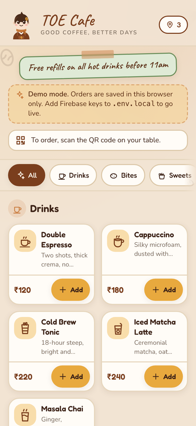
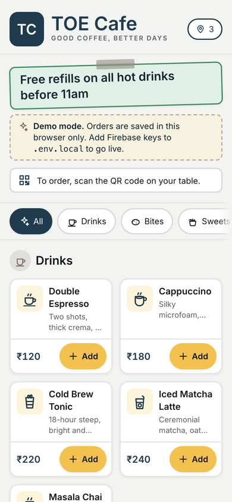
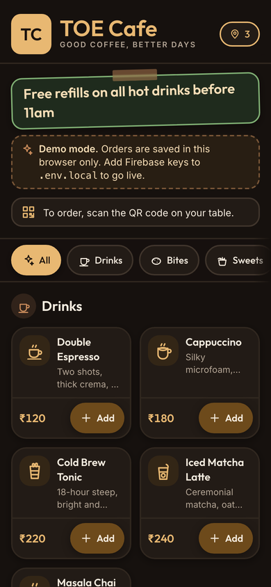
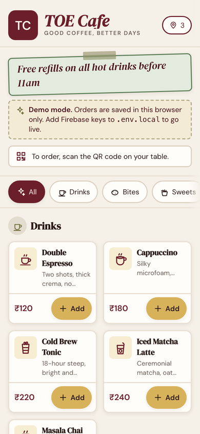

# Themes — Design Guidelines

A cafe picks one of four theme presets (`settings.theme`) and may add its own
accent colour and logo. **Cozy** is TOE's original anime-cafe look, unchanged;
the other three are quieter. One build carries all four, and the page picks
one at runtime.

| Cozy                                             | Minimal                                            | Dark                                   | Bistro                                   |
| ------------------------------------------------ | -------------------------------------------------- | -------------------------------------- | ---------------------------------------- |
|                          |                      |                |              |
| Warm cream, roasted brown, hand lettering, Mochi | White cards on quiet grey, one slate accent, Inter | Dark roast, caramel accent, light text | Ivory, oxblood and brass, serif headings |

## 1. Themes and how they apply

- **The tokens.** `src/app/globals.css` has one token set per preset:
  `:root, [data-theme="cozy"]` and then `[data-theme="minimal" | "dark" |
"bistro"]`. Components only ever use the tokens (`text-primary`,
  `bg-paper`, …), never a hex, so a component looks right on every preset
  without knowing which one it is on. The colours are also in
  `@cafemenu/shared` (`themes.ts`), for the manifest, the accent guard and the
  console; `src/lib/__tests__/theme.test.ts` fails if the two disagree.
- **Choosing one.** One build serves every cafe, so the static HTML has no
  theme. An inline script in `<head>` (`src/lib/theme.ts`) paints the theme the
  device last saw before the first frame, or asks `site.json` on a first visit;
  `<CafeTheme>` then applies the cafe's settings (theme, accent, toolbar colour)
  and keeps the copy for next time. A page with no `data-theme` is Cozy.
- **Cozy is TOE, pixel for pixel.** Its values, fonts and font stacks are
  exactly TOE's. With no logo, every screen renders byte-identical to the
  pre-theme build.
- **The accent.** `settings.accent` replaces `--primary` and its two twins.
  It must reach WCAG AA (4.5:1) as text on the page surfaces and under the
  button text. A colour that falls short is darkened (lightened on Dark) just
  far enough, keeping its hue, the way TOE's `-deep` tokens were made by hand
  (`accentColours` in `@cafemenu/shared`). The console's form uses
  `checkAccent`, which refuses the colour and offers the passing one instead.
- **Browser and home screen.** `theme-color` and the manifest's colours come
  from the theme: the accent on Cozy and Bistro, the page colour on Minimal and
  Dark.
- **Decoration is Cozy's.** Mochi, the doodles and the sparkle burst show only
  on Cozy (`plain:hidden`, a Tailwind variant for "any other preset"). Where
  Mochi stood in for the cafe's mark, the other presets show the cafe's
  monogram.
- **Logo.** `settings.logo` replaces the mark in the customer, staff and owner
  headers, the install prompt and the printed QR cards, on every preset. The
  logo sits above the QR code, never on it, so the code keeps its full quiet
  zone and scans as before. The app icons are generated from it at deploy time
  (`appIcons` in `@cafemenu/shared/icons`), or from the monogram without one.
- **Print.** QR cards print in ink on white. Dark prints with a light token set
  (`src/app/print.css`), since its light text on unprinted dark backgrounds
  would vanish.

**Adding a preset:** add its id to `THEMES` and its palette to `THEME_PRESETS`
(both in `@cafemenu/shared`), a matching `[data-theme]` block in
`globals.css`, its fonts in `src/app/layout.tsx` with `preload: false`, then
run `npm run audit` against a build whose `site.json` uses it.

## 2. Color Palette

**Cozy is TOE's palette, and it is locked.** It started from the "Studio
Ghibli / Cozy" direction below: warm cream `#F2E4D3`, roasted brown `#7A3E1D`,
terracotta `#C97B3D`, mustard `#E8A93E`, sage `#6B8E5A` and berry `#C0505B`,
with darker `-deep` twins of the mid-tones that fail WCAG AA as text. The
original directions it was picked from, for the record:

- **Sakura / Pastel Anime:** soft pink `#FFB7C5`, cream white `#FFF8F0`, deep plum `#4A2C4D`, mint accent `#A0E7C4`
- **Shonen / Bold Anime:** vivid red `#E63946`, jet black `#1D1D1D`, electric blue `#3A86FF`, sunburst yellow `#FFD60A`
- **Studio Ghibli / Cozy:** warm cream `#F4EBD9`, forest green `#3C6E47`, terracotta `#D98E73`, soft brown `#6B4226`

The other presets are original palettes with the same token names, so every
pairing the app uses means the same thing on each: `-soft` is a tint behind
text, `-deep` and `-dark` are the stronger twins for text. On Dark the
stronger twin is the _lighter_ one. `packages/shared/src/__tests__/themes.test.ts`
checks every pairing on every preset reaches WCAG AA. Cozy is allowed TOE's
three known misses (muted and berry on the cream page), which the app never
uses for small text.

**Usage (every preset):**

- Background: the page (`cream`), with cards on `paper`
- Accent (`primary`): buttons, links, the cafe's name; `highlight` for "Add" and badges
- Dark colour (`ink`, `body`): text and headers

## 3. Typography

| Preset  | Headings and labels  | Body                  | Lettering (`font-hand`) |
| ------- | -------------------- | --------------------- | ----------------------- |
| Cozy    | Fredoka 500, 600     | Nunito 400, 600, 700  | Caveat 600, 700         |
| Minimal | Inter                | Inter 400, 600, 700   | Inter 600               |
| Dark    | Outfit 500, 600      | Inter                 | Outfit 600              |
| Bistro  | DM Serif Display 400 | DM Sans 400, 600, 700 | DM Serif Display italic |

- **Headers/Logo:** a display face with some character; on Cozy a bold, rounded, slightly playful one (Fredoka)
- **Body/menu text:** a clean, highly legible sans-serif. Decorative faces stay in headers and accents, not small item descriptions
- Avoid hard-to-read fonts for prices and item names: customers need to read these fast

## 4. Visual Elements

On Cozy only:

- **Mascot character:** Mochi, a small chibi barista, original to this project, on the order confirmation screen, empty states ("no orders yet") and loading screens
- **Doodles:** a few low-opacity coffee beans, leaves and steam in the corners
- **Subtle sparkle/petal animation** on a successful order: brief (1–2 sec), so it doesn't slow down repeat use
- **Speech-bubble UI accents:** order confirmations styled like manga speech bubbles ("Order received! (๑˃ᴗ˂)ﻭ")

On every preset:

- **The cafe's mark:** its logo, or its monogram (the first letters of its name on a tile of its accent; Mochi on Cozy). The same monogram is drawn into the app icons
- **Rounded corners:** cards, buttons, menu items. Minimal and Bistro use smaller radii
- **Category icons** for menu categories (drinks, snacks, desserts) instead of plain text labels
- **Status badges styled like "power-up" tags:** "Preparing ⚡", "Ready ✨" instead of plain gray text

## 5. Page-by-Page Notes

**Customer Order Page**

- Header: the cafe's mark and its name in the preset's lettering face
- Menu as card grid with rounded item cards, item image (or icon if no photo), name, price, "+ Add" button in accent color
- Cart drawer/bottom sheet slides up with a playful transition
- Order confirmation: speech bubble + order number, shown big and clear (and Mochi, on Cozy)

**Staff View**

- Keep this **more functional/less decorative** — staff need speed, not animation, during rush hours
- Light theming only: accent colors on status buttons, the cafe's mark in the header
- New order alert: a distinct color flash/border + sound, not just a toast

## 6. Implementation Notes

- **CSS variables** for every token, one set per preset (§1), so a component never knows which theme it is on
- Google Fonts through `next/font`, self-hosted, only the weights used. A browser downloads a family only when its theme uses it. Cozy's three are preloaded, as TOE always did, so a Cozy cafe is exactly as fast as before; a cafe on another preset also fetches those three preloads (about 140 kB of fonts) it never uses, the price of one build serving every cafe
- First-load JavaScript with all four presets: 103 kB shared, as with one; `/order` unchanged at 130 kB, `/staff` and `/admin/qr` 1 kB more, `/offline` 2 kB more (the accent maths and the mark). The stylesheet grows from 51 to 67 kB uncompressed, mostly the other presets' `@font-face` rules
- Keep animations CSS-based (transforms/opacity), avoid heavy JS animation libraries — the page needs to load fast on cafe wifi/mobile data
- Mascot/illustrations are original, hand-authored SVG; never copyrighted anime characters or studio IP

## 7. Things to Avoid

- Don't reference or reuse existing copyrighted anime characters, series names, or studio branding (legal risk + inconsistent brand identity)
- Don't let decorative elements slow down the actual ordering flow — a theme should feel light and fast, not heavy
- Don't over-animate the staff app — it needs to prioritize speed and clarity during busy hours
- Don't put a hex colour in a component, or text on a mid-tone token: use a `-deep` twin, and run `npm run audit` on every preset after changing a colour
