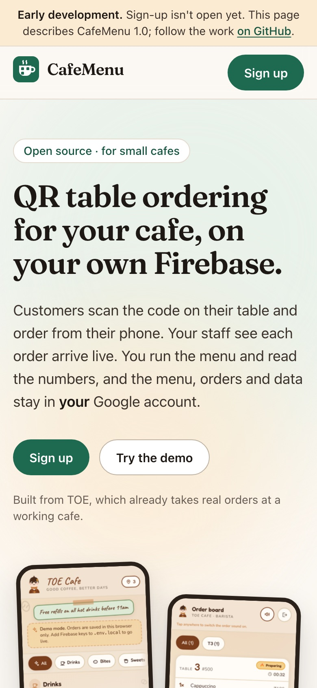
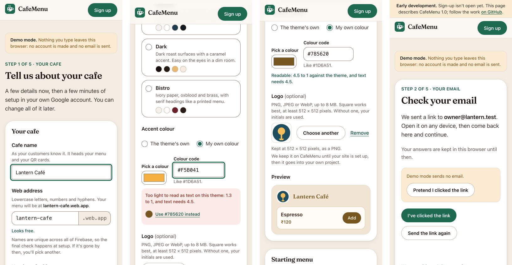
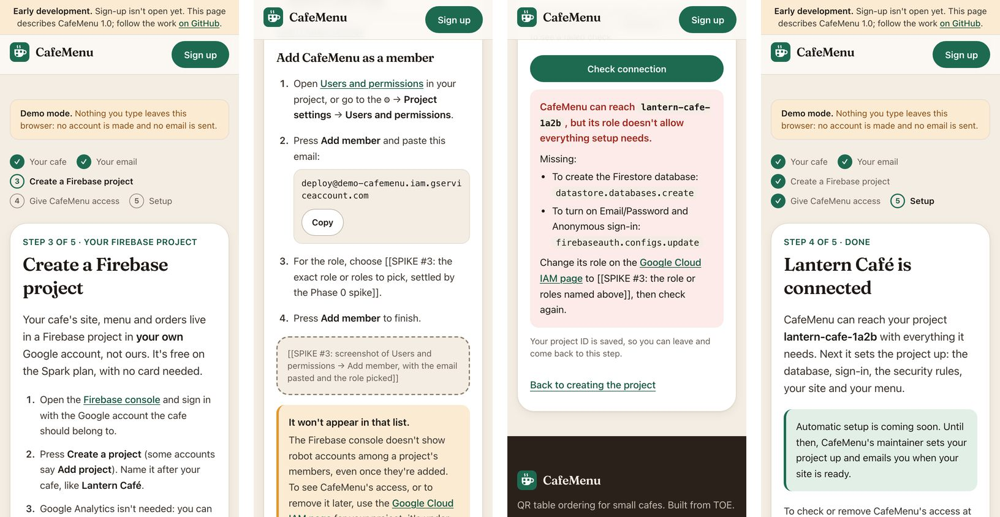

# CafeMenu console

The CafeMenu website: what CafeMenu is, and, as Phase 3 lands, where a cafe
owner signs up, connects their own Firebase project and picks which release
their cafe runs, and where the maintainer runs releases. It is hosted on the
platform's own Firebase project. A cafe's menu and orders never come here;
they live in the owner's project ([PLAN.md](../../PLAN.md#how-it-fits-together)).

Today it has the landing page ([#25](https://github.com/shreyashp47/cafemenu/issues/25)),
the sign-up form and email check ([#26](https://github.com/shreyashp47/cafemenu/issues/26)),
onboarding ([#27](https://github.com/shreyashp47/cafemenu/issues/27)), and the
platform's data model, sign-in and security rules
([#24](https://github.com/shreyashp47/cafemenu/issues/24)), which automatic
setup (#28), the owner area (#29) and admin (#30) build on.

Same stack as the cafe app, on the same versions: Next.js 15 (static export),
React 19, TypeScript, Tailwind CSS v4, Firebase 12, Vitest.

<p align="center">
  
</p>

## Run it

From the repository root, once:

```bash
npm ci
```

Then:

```bash
npm run dev -w @cafemenu/console     # http://localhost:3100
```

Port 3100, so the cafe app can run on 3000 beside it.

### Sign-up

`/signup` is steps 1 and 2 of [the owner's steps](../../PLAN.md#the-owners-steps-steps-to-own-it):

1. **The form**: cafe name, web address, number of tables; country, which
   fills in the currency, time zone, number and date format and where the
   data is kept (all four editable); theme, accent colour (with a live
   preview and the shared contrast guard from `@cafemenu/shared`) and logo;
   the starting menu (a shared starter, a pasted list or CSV read by the
   shared import, or blank); and the owner's email and password.
2. **The email link.** The account is made when the form is sent, which
   sends the link; the rules refuse every write until it is clicked, so the
   form waits in the browser as a draft (`src/lib/signup/draft.ts`, never the
   password). Once verified, the page saves the cafe as a `draft`, then its
   logo and starting menu.

<p align="center">
  
</p>

What the form decides is plain data in [`src/lib/signup/`](./src/lib/signup),
tested without a browser; the components in `src/components/signup/` only
show it. A reload or a return comes back to the same step.

- **Web address.** The format is the rules' (`SITE_NAME`); nearby names are
  offered when one is taken or malformed. Whether a name is free can only be
  known for sure at setup, since names are unique across all of Firebase, and
  the form says so. Until then the check is a `SiteNameChecker`
  (`src/lib/data/checks.ts`): simulated in demo mode and the emulators (a few
  common words, and the demo's own cafes, are "taken"), and "unknown" against
  the real platform until the backend can try a validate-only `sites.create`
  ([#28](https://github.com/shreyashp47/cafemenu/issues/28)).
- **Logo.** PNG, JPEG or WebP up to 8 MB, at least 192 px on its longer side.
  The browser redraws it as a PNG of at most 512 px (the largest icon; it also
  drops camera data) and shrinks it further if it would pass 750 kB.
- **Against the real platform** the page stays "coming soon" until
  `NEXT_PUBLIC_SIGNUP_OPEN=1`, so the landing page can go live first.

### Onboarding

`/setup` is steps 3 and 4: **create a Firebase project** on the free Spark
plan, then **give CafeMenu access** (paste the project's ID, add the deploy
account as a member under Settings → Users and permissions, and press
**Check connection**). It says plainly that the member won't show in the
Firebase console's list, and links to the Google Cloud IAM page, where it
does and where it can be removed.

<p align="center">
  
</p>

- The wizard is a state machine in
  [`src/lib/setup/wizard.ts`](./src/lib/setup/wizard.ts), tested without a
  browser. The project ID is saved on the cafe before each check; the step
  and the last answer are kept in this browser; so an owner who leaves comes
  back to the same step, and on another device to the access step.
- **Check connection** asks a `ConnectionChecker`
  ([`src/lib/setup/connection.ts`](./src/lib/setup/connection.ts)), whose
  answer has the shape of `deployer check`'s: connected, no access, or each
  missing permission with what it is for. Demo mode and the emulators
  simulate it (a project ID ending in `-noaccess` or `-missing` shows those
  answers); against the real platform it waits for the backend to run
  `deployer check` (#28).
- The deploy account's address comes from `NEXT_PUBLIC_DEPLOY_SERVICE_ACCOUNT`
  (a `demo-` stand-in in demo mode and the emulators). The exact role to pick
  and the screenshots of Google's consoles are marked `[[SPIKE #3: …]]` in
  `messages/en.json` until the Phase 0 spike settles them; a test keeps every
  such placeholder in that form.

### Three backends

| Mode          | How                                                           | What it talks to                                                                   |
| ------------- | ------------------------------------------------------------- | ---------------------------------------------------------------------------------- |
| **Demo**      | the default: no `.env.local`                                  | localStorage in your browser. No account, nothing sent, no email.                  |
| **Emulators** | `NEXT_PUBLIC_FIREBASE_EMULATORS=1` and `npm run emulators`    | the Auth and Firestore emulators, project `demo-cafemenu`. Java 21                 |
| **Firebase**  | the six `NEXT_PUBLIC_FIREBASE_*` values from the platform app | the real platform project ([#2](https://github.com/shreyashp47/cafemenu/issues/2)) |

See [.env.example](./.env.example). Demo mode applies the same checks as the
rules, with the same error codes, so a page built against it does not then
fail on permissions. It sends no verification email: `demoVerifyEmail()` in
`src/lib/data/demo.ts` stands in for the link.

The emulators' ports (Auth 9199, Firestore 8180, UI 4010) differ from the cafe
app's, so both can run at once.

## The platform database

Types in [`src/lib/platform/model.ts`](./src/lib/platform/model.ts), rules in
[`firestore.rules`](./firestore.rules).

| Path                 | What                                                       | Written by                                      | Read by                      |
| -------------------- | ---------------------------------------------------------- | ----------------------------------------------- | ---------------------------- |
| `cafes/{cafeId}`     | one per cafe                                               | its owner (some fields), the backend (the rest) | its owner, the admin         |
| `releases/{version}` | one per published release, id `1.4.2`                      | the backend only                                | any verified account         |
| `deployments/{id}`   | one per setup, deploy, rollback or branding sync of a cafe | the backend only                                | that cafe's owner, the admin |
| `cafes/{id}/setup/…` | the logo and starting menu from sign-up                    | its owner, while the cafe is a draft            | its owner, the admin         |

A cafe:

| Field                    | Meaning                                                                      | Owner may set                   |
| ------------------------ | ---------------------------------------------------------------------------- | ------------------------------- |
| `ownerUid`               | the platform account that owns it                                            | at creation, as self            |
| `ownerEmail`             | that account's email                                                         | at creation, as own             |
| `projectId`              | the owner's Firebase project; `null` until the access step                   | while `draft`                   |
| `site`                   | Hosting site name: `their-cafe` → their-cafe.web.app                         | while `draft`                   |
| `region`                 | the Firestore location for the cafe's database: `asia-south1`, `nam5`        | while `draft`                   |
| `settings`               | `CafeSettings` from `@cafemenu/shared`: name, theme, accent, currency, zone… | yes, except `plan`              |
| `release.channel`        | `stable` or `beta`                                                           | yes                             |
| `release.pinned`         | a minor line (`"1.4"`) to stay on, or `null`; patches of it still apply      | yes                             |
| `release.current`        | the version deployed now; `null` before the first deploy                     | **never**                       |
| `release.previous`       | the version before it: where Roll back goes                                  | **never**                       |
| `status`                 | `draft` → `provisioning` → `live`; or `failed`, `disconnected`, `suspended`  | **never** (`draft` at creation) |
| `createdAt`, `updatedAt` | server time                                                                  | stamped by the server           |

Under a draft cafe, two documents hold what sign-up collected until
provisioning ([#28](https://github.com/shreyashp47/cafemenu/issues/28))
copies it into the owner's own project:

| Document     | What                                                                                                                         |
| ------------ | ---------------------------------------------------------------------------------------------------------------------------- |
| `setup/logo` | `png`: the logo as Firestore bytes, a PNG of at most 512 px and 750 kB; `updatedAt`                                          |
| `setup/menu` | `source` (`template`, `import`, `blank`), `template` (the starter's id), `currency`, `items` (at most 200 rows); `updatedAt` |

The rules check their shape and size, that the menu is priced in the cafe's
own currency, and that the cafe is the caller's and still a draft. They can't
look inside every menu row or decode a PNG, so the deployer checks both again
before using them, as it does the settings.

**Where the logo goes in production:** the same document, in the platform
project's Firestore. Provisioning reads it, makes `/logo.png` and the app
icons with `siteLogo` and `appIcons` from `@cafemenu/shared/icons` (what
`deployer deploy --logo` does today), deploys them into the cafe's own
Hosting site with `settings.logo` set to `/logo.png`, and can then delete the
document. A 512-px PNG fits a Firestore document easily; if logos ever need
more room, Cloud Storage on the platform project (on Blaze already, for
Functions) is the place, with storage rules mirroring these.

A deployment carries `cafeId`, `ownerUid` (copied, so an owner's query can be
proved by the rules), `kind` (`provision`, `deploy`, `rollback`, `branding`),
`version`, `fromVersion`, `status` (`queued`, `running`, `succeeded`,
`failed`, `rolled-back`), `trigger` (`owner`, `rollout`, `admin`), `steps` for
the progress screen, `error`, `createdAt` and `finishedAt`.

A release carries `channel`, Markdown `notes`, `publishedAt`, the
`schemaVersion` it expects in each cafe's database, and `withdrawn`.

**Accounts.** Email and password, with email verification: the rules refuse
every write from an unverified account, reading `email_verified` from the ID
token, so the console refreshes the token after the link is clicked
(`AuthRepository.refresh()`). The maintainer has the custom claim
`admin: true`, which only the Admin SDK can set; an admin reads everything,
and writes through the backend like everyone else.

**The backend** (the deployer, and the Cloud Functions to come in
[#28](https://github.com/shreyashp47/cafemenu/issues/28)) writes with the
platform service account, which Firestore does not hold to the rules. It is
the only writer of releases, deployments, a cafe's status, its plan and
`release.current`/`previous`. Upgrade and Roll back (#29) will be requests to
it, not client writes.

## Checks

```bash
npm run verify -w @cafemenu/console        # lint, typecheck, unit tests, build
npm run format:check -w @cafemenu/console
```

Rules and Firebase code, against the emulators (Java 21+; from `apps/console`):

```bash
npm run emulators            # terminal 1
npm run test:rules           # terminal 2: attacks firestore.rules
npm run test:emulators       # terminal 2: the console's Firebase adapters through them
```

or in one go:

```bash
firebase emulators:exec --only auth,firestore --project demo-cafemenu "npm run test:rules && npm run test:emulators"
```

Both wipe the emulators' data first and refuse a project ID that does not
start with `demo-`.

Pages, with Playwright (`npx playwright install chromium webkit` once):

```bash
npm run screenshot           # every page at 4 widths into .screenshots/; fails on overflow
npm run audit                # WCAG 2.1 A/AA with axe, in Chromium and WebKit

Both look at the steps behind a page too (the form's problems, the accent
warning, the email check, each onboarding step), from demo states in
[`scripts/lib/demo-states.mjs`](./scripts/lib/demo-states.mjs) and the
routes in `scripts/lib/server.mjs`.
```

CI runs all of it in [`.github/workflows/console.yml`](../../.github/workflows/console.yml)
on every pull request, and checks that the rules test fails when a rule is
deliberately broken.

## Design

The console has its own look, separate from any cafe's theme: warm paper,
espresso ink, a basil green. Colours are tokens in
[`src/app/globals.css`](./src/app/globals.css); never put a hex in a component.
Text pairs and their contrast (WCAG AA needs 4.5:1):

| Text            | On                                  |           Ratio |
| --------------- | ----------------------------------- | --------------: |
| `text`          | `paper`                             |            11.7 |
| `muted`         | `paper` / `sunk`                    |       6.1 / 5.5 |
| `brand-ink`     | `paper`                             |             8.2 |
| white           | `brand`                             |             6.5 |
| `brand-soft`    | `brand`                             |             5.4 |
| `accent-ink`    | `accent-soft`                       |             5.9 |
| `on-dark`       | `espresso`                          |            13.9 |
| `on-dark-muted` | `espresso`                          |             8.6 |
| `accent`        | `espresso`                          |             6.5 |
| `danger`        | `surface` / `paper` / `danger-soft` | 7.4 / 7.0 / 6.4 |

Form fields are edged in `line-field`, 4.0:1 on `surface` (WCAG asks 3:1 of a
control's edge); `line-strong` is for decoration only.

Headings use Fraunces at one weight, self-hosted by `next/font`; body text is
the system font. Every word is in [`messages/en.json`](./messages/en.json),
with `**bold**`, `` `code` `` and `[links](https://…)` rendered by
`<Rich>`, never as HTML.

The screenshots in `public/screens` are the cafe app's, from
`apps/cafe/docs/screens`, except `06-qr-cards.png`: that one is retaken in
demo mode, because the original shows a live cafe's address and the top of
its table codes. **Never link people to a real cafe's site to try ordering.**
