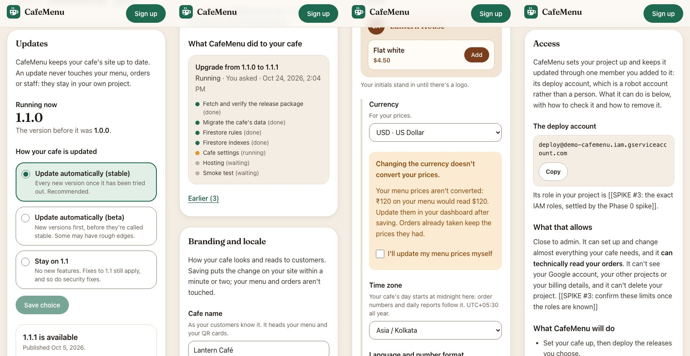
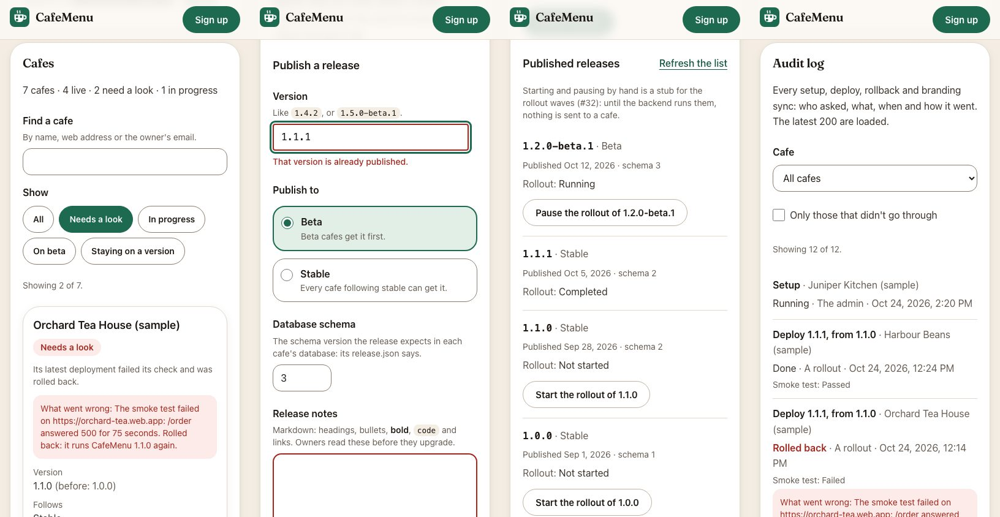

# CafeMenu console

The CafeMenu website: what CafeMenu is, and, as Phase 3 lands, where a cafe
owner signs up, connects their own Firebase project and picks which release
their cafe runs, and where the maintainer runs releases. It is hosted on the
platform's own Firebase project. A cafe's menu and orders never come here;
they live in the owner's project ([PLAN.md](../../PLAN.md#how-it-fits-together)).

Today it has the landing page ([#25](https://github.com/shreyashp47/cafemenu/issues/25)),
the sign-up form and email check ([#26](https://github.com/shreyashp47/cafemenu/issues/26)),
onboarding ([#27](https://github.com/shreyashp47/cafemenu/issues/27)), the
owner area ([#29](https://github.com/shreyashp47/cafemenu/issues/29)), the
platform admin ([#30](https://github.com/shreyashp47/cafemenu/issues/30)), and
the platform's data model, sign-in and security rules
([#24](https://github.com/shreyashp47/cafemenu/issues/24)), which automatic
setup (#28) builds on.

Same stack as the cafe app, on the same versions: Next.js 15 (static export),
React 19, TypeScript, Tailwind CSS v4, Firebase 12, Vitest.

<p align="center">
  
</p>

## Run it

From the repository root, once:

```bash
npm ci
```

Then:

```bash
npm run dev -w @cafemenu/console     # http://localhost:3100
```

Port 3100, so the cafe app can run on 3000 beside it.

### Sign-up

`/signup` is steps 1 and 2 of [the owner's steps](../../PLAN.md#the-owners-steps-steps-to-own-it):

1. **The form**: cafe name, web address, number of tables; country, which
   fills in the currency, time zone, number and date format and where the
   data is kept (all four editable); theme, accent colour (with a live
   preview and the shared contrast guard from `@cafemenu/shared`) and logo;
   the starting menu (a shared starter, a pasted list or CSV read by the
   shared import, or blank); and the owner's email and password.
2. **The email link.** The account is made when the form is sent, which
   sends the link; the rules refuse every write until it is clicked, so the
   form waits in the browser as a draft (`src/lib/signup/draft.ts`, never the
   password). Once verified, the page saves the cafe as a `draft`, then its
   logo and starting menu.

<p align="center">
  
</p>

What the form decides is plain data in [`src/lib/signup/`](./src/lib/signup),
tested without a browser; the components in `src/components/signup/` only
show it. A reload or a return comes back to the same step.

- **Web address.** The format is the rules' (`SITE_NAME`); nearby names are
  offered when one is taken or malformed. Whether a name is free can only be
  known for sure at setup, since names are unique across all of Firebase, and
  the form says so. Until then the check is a `SiteNameChecker`
  (`src/lib/data/checks.ts`): simulated in demo mode and the emulators (a few
  common words, and the demo's own cafes, are "taken"), and "unknown" against
  the real platform until the backend can try a validate-only `sites.create`
  ([#28](https://github.com/shreyashp47/cafemenu/issues/28)).
- **Logo.** PNG, JPEG or WebP up to 8 MB, at least 192 px on its longer side.
  The browser redraws it as a PNG of at most 512 px (the largest icon; it also
  drops camera data) and shrinks it further if it would pass 750 kB.
- **Against the real platform** the page stays "coming soon" until
  `NEXT_PUBLIC_SIGNUP_OPEN=1`, so the landing page can go live first.

### Onboarding

`/setup` is steps 3 and 4: **create a Firebase project** on the free Spark
plan, then **give CafeMenu access** (paste the project's ID, add the deploy
account as a member under Settings → Users and permissions, and press
**Check connection**). It says plainly that the member won't show in the
Firebase console's list, and links to the Google Cloud IAM page, where it
does and where it can be removed.

<p align="center">
  
</p>

- The wizard is a state machine in
  [`src/lib/setup/wizard.ts`](./src/lib/setup/wizard.ts), tested without a
  browser. The project ID is saved on the cafe before each check; the step
  and the last answer are kept in this browser; so an owner who leaves comes
  back to the same step, and on another device to the access step.
- **Check connection** asks a `ConnectionChecker`
  ([`src/lib/setup/connection.ts`](./src/lib/setup/connection.ts)), whose
  answer has the shape of `deployer check`'s: connected, no access, or each
  missing permission with what it is for. Demo mode and the emulators
  simulate it (a project ID ending in `-noaccess` or `-missing` shows those
  answers); against the real platform the backend runs `deployer check` (see
  [the backend switch](#three-backends)). With the backend on GitHub Actions
  the check is a request it picks up on its next run: the page says this takes
  a few minutes and shows whether CafeMenu has picked it up, until the answer
  comes.
- The deploy account's address comes from `NEXT_PUBLIC_DEPLOY_SERVICE_ACCOUNT`
  (a `demo-` stand-in in demo mode and the emulators). The exact role to pick
  and the screenshots of Google's consoles are marked `[[SPIKE #3: …]]` in
  `messages/en.json` until the Phase 0 spike settles them; a test keeps every
  such placeholder in that form.

### The owner area

`/cafe` is where an owner manages a cafe that is past setup (`?cafe=` picks
one of several; sign-up and `/setup` link to it). It shows the cafe's name and
state, a link to the cafe's own dashboard at `https://<site>.web.app/admin`
(menu, tables, orders and staff are managed there, in the owner's project;
in demo mode the address is shown, not linked, because there is no real site),
and three sections:

<p align="center">
  
</p>

- **Updates.** The version running, and how the cafe follows releases: every
  new stable version, every new beta, or **Stay on 1.4** (patches of that line
  still apply, so security fixes reach everyone). That choice is saved on the
  cafe's record, which the rules let the owner write
  (`release.channel` and `release.pinned`). **Upgrade** offers the newest
  release the cafe follows that is newer than its own, with its notes from
  `releases/{version}`; **Roll back** goes to `release.previous`, after asking.
  A cafe that stays on a line and upgrades past it moves the line it stays on,
  or the next patch of the old one would undo the upgrade. Below them is what
  CafeMenu has done to the cafe, from `deployments/`: the latest in full, with
  the deployer's steps while it runs or if it failed.
- **Branding and locale.** Name, tagline, logo, theme, accent (with the shared
  contrast guard, as at sign-up), currency, time zone and language. Save writes
  the cafe's settings, and a new logo, on the platform, then asks for them to
  go on the site. Changing the currency says that prices are not converted
  and wants a tick first. The tables, order cap, address on the QR cards,
  money unit and plan are not edited here and carry over.
- **Access.** What CafeMenu can do in the owner's project, how to check it on
  the Google Cloud IAM page (linked with their project picked), how to remove
  it, and what leaving means. The words are
  [docs/legal/access-explained.md](../../docs/legal/access-explained.md)'s, and
  wait for the same things: the deploy account's role is a `[[SPIKE #3: …]]`.

**Requests to the backend.** The console never deploys anything. Upgrade,
Roll back and Save in Branding are calls on `DeployRequests`
([`src/lib/data/types.ts`](./src/lib/data/types.ts)), which reach the backend
([`apps/platform-functions`](../platform-functions/README.md)) one of two
ways:

- **As requests** (`NEXT_PUBLIC_BACKEND=requests`, the backend on GitHub
  Actions, #77): each writes a `requests/{id}`
  ([`src/lib/data/requests.ts`](./src/lib/data/requests.ts)) and returns at
  once. The page says it takes a few minutes; the owner area watches the
  owner's latest requests for the cafe, shows one until the backend has made
  it a deployment (or refused it, with its reason), and holds the buttons
  meanwhile.
- **As calls** (`NEXT_PUBLIC_BACKEND=functions`, Cloud Functions on Blaze):
  the backend queues a `deployments/{id}` at once.

Either way the backend runs the deployer (`deployer deploy --version`,
`deployer rollback`, `deployer sync-branding`) and writes the steps, the
result and `release.current`/`previous` to the deployment, which the page
watches. With neither, the real platform answers `backend-pending`
(src/lib/data/deploys.ts), and the page says nothing was changed, or that the
branding is saved and waits. Demo mode simulates the backend
([`src/lib/data/demo-deploys.ts`](./src/lib/data/demo-deploys.ts)): the
deployer's own steps, one at a time, then the new version; the demo has no
backend to finish setup, so a draft cafe in `/cafe` has a "Pretend setup
finished" button. One request runs at a time per cafe, and the buttons wait.

**The logo.** The rules let an owner replace `cafes/{id}/setup/logo` while the
cafe is `draft` or `live` (`provisioning`, `failed`, `disconnected` and
`suspended` cafes' logos are fixed, and the starting menu stays draft-only).
The backend reads it for `deployer sync-branding --logo`.

What the sections decide is plain data in
[`src/lib/owner/`](./src/lib/owner) and [`src/lib/notes.ts`](./src/lib/notes.ts)
(release notes: a small, safe part of Markdown), tested without a browser.

### Three backends

| Mode          | How                                                           | What it talks to                                                                   |
| ------------- | ------------------------------------------------------------- | ---------------------------------------------------------------------------------- |
| **Demo**      | the default: no `.env.local`                                  | localStorage in your browser. No account, nothing sent, no email.                  |
| **Emulators** | `NEXT_PUBLIC_FIREBASE_EMULATORS=1` and `npm run emulators`    | the Auth and Firestore emulators, project `demo-cafemenu`. Java 21                 |
| **Firebase**  | the six `NEXT_PUBLIC_FIREBASE_*` values from the platform app | the real platform project ([#2](https://github.com/shreyashp47/cafemenu/issues/2)) |

See [.env.example](./.env.example). Demo mode applies the same checks as the
rules, with the same error codes, so a page built against it does not then
fail on permissions. It sends no verification email: `demoVerifyEmail()` in
`src/lib/data/demo.ts` stands in for the link.

The emulators' ports (Auth 9199, Firestore 8180, UI 4010) differ from the cafe
app's, so both can run at once.

**The platform's backend** (`apps/platform-functions`) is a switch on top of
the last two modes, `NEXT_PUBLIC_BACKEND`:

| Value       | Check connection, Upgrade, Roll back and Save branding                                                                     |
| ----------- | -------------------------------------------------------------------------------------------------------------------------- |
| `requests`  | write a `requests/{id}` the backend's GitHub Actions job picks up within minutes, and follow it live. Free, on Spark (#77) |
| `functions` | call its Cloud Functions ([`src/lib/data/callables.ts`](./src/lib/data/callables.ts)), which answer at once. Needs Blaze   |
| (empty)     | a stand-in answers on the emulators; the real platform says the backend isn't switched on yet                              |

(`NEXT_PUBLIC_BACKEND_FUNCTIONS=1`, the old switch, still means `functions`.)
Against the emulators: with `requests`, run the worker beside this app's
emulators (the platform-functions README, [Running it
locally](../platform-functions/README.md#running-it-locally)); with
`functions`, start that app's `npm run emulators` in place of this one's, on
the same Auth and Firestore ports, plus Functions on 5101. In demo mode
nothing changes.

## Real mode (the platform project)

What the maintainer does once to move the live console
(<https://getcafemenu.web.app>) from demo mode onto the platform project
`getcafemenu`, on the free Spark plan, with the backend on GitHub Actions.
**Nothing here has been done yet**, and none of it can be undone without
losing what owners have entered, so take it in order.

1. **The Firestore database.** Firebase console → `getcafemenu` → **Build →
   Firestore Database → Create database**: Standard edition, ID `(default)`,
   location **`asia-south1` (Mumbai)**, starting in production mode (the
   rules come next). The location can never be changed.
2. **Sign-in.** **Build → Authentication → Get started → Sign-in method →
   Email/Password → Enable** (the first switch, not "Email link"). Under
   **Settings → Authorized domains**, `getcafemenu.web.app` is there already;
   add a custom domain if the console gets one.
3. **The rules and indexes**, from this folder:

   ```bash
   npx firebase-tools deploy --only firestore:rules,firestore:indexes --project getcafemenu
   ```

   The indexes take a few minutes to build; until they have, the backend's
   and the owner area's queries fail.

4. **The backend**: the service account, its key as the
   `PLATFORM_SERVICE_ACCOUNT` secret, and the `production` environment, as
   the platform-functions README's [Setting it
   up](../platform-functions/README.md#setting-it-up) says.
5. **The build values.** **Project settings → General → Your apps → Add app →
   Web** (no Hosting), then copy its config into
   `apps/console/.env.production.local` (git ignores it), which `next build`
   reads:

   ```bash
   NEXT_PUBLIC_FIREBASE_API_KEY=…
   NEXT_PUBLIC_FIREBASE_AUTH_DOMAIN=getcafemenu.firebaseapp.com
   NEXT_PUBLIC_FIREBASE_PROJECT_ID=getcafemenu
   NEXT_PUBLIC_FIREBASE_STORAGE_BUCKET=…
   NEXT_PUBLIC_FIREBASE_MESSAGING_SENDER_ID=…
   NEXT_PUBLIC_FIREBASE_APP_ID=…
   NEXT_PUBLIC_BACKEND=requests
   NEXT_PUBLIC_DEPLOY_SERVICE_ACCOUNT=cafemenu-deploy@getcafemenu.iam.gserviceaccount.com
   # NEXT_PUBLIC_SIGNUP_OPEN=1    only when sign-up should open
   ```

   None of these is a secret: they are in every page the console serves, and
   the rules protect the data.

6. **Rebuild and redeploy** both live sites: `./scripts/deploy-live.sh` from
   the repository root. The console leaves demo mode (its demo notice goes).
7. **Check:** sign up as a test owner, connect a test project, press **Check
   connection** and wait for the answer (up to about 5 minutes).

## The platform database

Types in [`src/lib/platform/model.ts`](./src/lib/platform/model.ts), rules in
[`firestore.rules`](./firestore.rules).

| Path                 | What                                                       | Written by                                                      | Read by                      |
| -------------------- | ---------------------------------------------------------- | --------------------------------------------------------------- | ---------------------------- |
| `cafes/{cafeId}`     | one per cafe                                               | its owner (some fields), the backend (the rest)                 | its owner, the admin         |
| `releases/{version}` | one per published release, id `1.4.2`                      | the backend only                                                | any verified account         |
| `deployments/{id}`   | one per setup, deploy, rollback or branding sync of a cafe | the backend only                                                | that cafe's owner, the admin |
| `cafes/{id}/setup/…` | the logo and starting menu from sign-up                    | its owner, while the cafe is a draft (the logo also while live) | its owner, the admin         |
| `requests/{id}`      | something asked of the backend (#77)                       | its asker once, queued, for their own cafe; then the backend    | its asker, the admin         |

A cafe:

| Field                    | Meaning                                                                      | Owner may set                   |
| ------------------------ | ---------------------------------------------------------------------------- | ------------------------------- |
| `ownerUid`               | the platform account that owns it                                            | at creation, as self            |
| `ownerEmail`             | that account's email                                                         | at creation, as own             |
| `projectId`              | the owner's Firebase project; `null` until the access step                   | while `draft`                   |
| `site`                   | Hosting site name: `their-cafe` → their-cafe.web.app                         | while `draft`                   |
| `region`                 | the Firestore location for the cafe's database: `asia-south1`, `nam5`        | while `draft`                   |
| `settings`               | `CafeSettings` from `@cafemenu/shared`: name, theme, accent, currency, zone… | yes, except `plan`              |
| `release.channel`        | `stable` or `beta`                                                           | yes                             |
| `release.pinned`         | a minor line (`"1.4"`) to stay on, or `null`; patches of it still apply      | yes                             |
| `release.current`        | the version deployed now; `null` before the first deploy                     | **never**                       |
| `release.previous`       | the version before it: where Roll back goes                                  | **never**                       |
| `status`                 | `draft` → `provisioning` → `live`; or `failed`, `disconnected`, `suspended`  | **never** (`draft` at creation) |
| `createdAt`, `updatedAt` | server time                                                                  | stamped by the server           |

Under a draft cafe, two documents hold what sign-up collected until
provisioning ([#28](https://github.com/shreyashp47/cafemenu/issues/28))
copies it into the owner's own project:

| Document     | What                                                                                                                         |
| ------------ | ---------------------------------------------------------------------------------------------------------------------------- |
| `setup/logo` | `png`: the logo as Firestore bytes, a PNG of at most 512 px and 750 kB; `updatedAt`                                          |
| `setup/menu` | `source` (`template`, `import`, `blank`), `template` (the starter's id), `currency`, `items` (at most 200 rows); `updatedAt` |

The rules check their shape and size, that the menu is priced in the cafe's
own currency, and that the cafe is the caller's and still a draft. They can't
look inside every menu row or decode a PNG, so the deployer checks both again
before using them, as it does the settings.

**Where the logo goes in production:** the same document, in the platform
project's Firestore. Provisioning reads it, makes `/logo.png` and the app
icons with `siteLogo` and `appIcons` from `@cafemenu/shared/icons` (what
`deployer deploy --logo` does today), deploys them into the cafe's own
Hosting site with `settings.logo` set to `/logo.png`, and can then delete the
document. A 512-px PNG fits a Firestore document easily; if logos ever need
more room, Cloud Storage on the platform project (on Blaze already, for
Functions) is the place, with storage rules mirroring these.

A deployment carries `cafeId`, `ownerUid` (copied, so an owner's query can be
proved by the rules), `kind` (`provision`, `deploy`, `rollback`, `branding`),
`version`, `fromVersion`, `status` (`queued`, `running`, `succeeded`,
`failed`, `rolled-back`), `trigger` (`owner`, `rollout`, `admin`), `steps` for
the progress screen, `error`, `createdAt` and `finishedAt`.

A release carries `channel`, Markdown `notes`, `publishedAt`, the
`schemaVersion` it expects in each cafe's database, and `withdrawn`.

A request carries what its asker wrote (`cafeId`, `kind`: `check`,
`provision`, `deploy`, `rollback` or `sync-branding`; `params`; `status`
`queued`; `createdAt`; `by`) and what the backend answers (`status`
`running`, `done` or `failed`; `progress`; `result`; `error`, `errorCode`;
`deploymentId`). The shape is
[`@cafemenu/shared/requests`](../../packages/shared/src/requests.mjs); the
platform-functions README has [every field](../platform-functions/README.md#a-request).

**Accounts.** Email and password, with email verification: the rules refuse
every write from an unverified account, reading `email_verified` from the ID
token, so the console refreshes the token after the link is clicked
(`AuthRepository.refresh()`). The maintainer has the custom claim
`admin: true`, which only the Admin SDK can set; an admin reads everything,
and writes through the backend like everyone else.

**The backend** (the deployer, run by
[`apps/platform-functions`](../platform-functions/README.md) on GitHub
Actions or as Cloud Functions) writes with the platform service account,
which Firestore does not hold to the rules. It is the only writer of
releases, deployments, a cafe's status, its plan, `release.current`/`previous`
and the answers to requests. Upgrade and Roll back are requests to it, not
client writes.

## The platform admin

`/admin` is the maintainer's page: not linked from anywhere, and a sign-in form
for everyone but an account with the `admin: true` claim (the rules are what
keep the data from anyone else; the page only declines to ask). It shows:

<p align="center">
  
</p>

- **Cafes.** One card per cafe: how it is doing (healthy, in progress, needs a
  look, paused, not set up), which release it runs and the one before, whether
  it follows stable, beta or stays on a line, its latest deployment, the last
  **smoke test** it had and when, the error if something failed, the owner and
  the address. Cafes that need a look come first; a search (name, address,
  owner's email) and filters (needs a look, in progress, on beta, staying on a
  version) narrow them. Health is worked out in
  [`src/lib/admin/overview.ts`](./src/lib/admin/overview.ts) from the cafe's
  status and its newest deployment, and the smoke result from the deployment's
  `smoke` step, the one the deployer records. Cards, not a table, so a phone
  has nothing to scroll sideways.
- **Releases.** Publish a release record (version, channel, notes, database
  schema), checked here for the mistakes that can be seen from here (a bad
  or already-published version, a pre-release going to stable, no notes) and
  then **asked of the backend** (`AdminRequests.publishRelease`; the
  `TODO(#28)` says the backend verifies the package on GitHub against what was
  entered and only then writes `releases/{version}`). Below, the published
  releases with a **Start / Pause / Resume** button for each one's rollout:
  a stub for v1.1's rollout waves ([#32](https://github.com/shreyashp47/cafemenu/issues/32)),
  which only records the state until the backend runs `deployer rollout` (the
  `TODO(#32)` names the commands and says the rollouts become `rollouts/{id}`
  documents, with rules for the admin to read them).
- **Audit log.** The latest 200 deployments of every cafe, newest first: what
  (setup, deploy and from which version, rollback, branding sync), the cafe,
  how it went, who asked (the owner's email, a rollout, or the admin), when,
  its smoke test and error. Narrowed to one cafe, or to those that didn't go
  through, 25 at a time.

What it deliberately lacks: **no way to sign in as an owner** (the
authentication repository has no such call, and a test keeps it so) **and no way
to read a cafe's orders**: they live in the owner's own project, and no path in
the platform database leads to them (the rules test tries `/orders`, `/staff`
and `/rollouts`, and is refused). Cafes are read-only: the admin cannot edit
one, move it to another owner, withdraw a release or start a deploy from a
browser, only ask the backend, which writes with its own account.

**The latest 200.** One query feeds the log and each cafe's last deploy
(`DeploymentRepository.subscribeRecent`: newest first, no filter, which only the
admin's claim lets through). A cafe whose newest deployment is older than the
latest 200 reads as having none, which is fine for dozens of cafes and is the
place to start if there are ever thousands (a `lastDeployment` on the cafe,
written by the backend).

**Demo mode** has an admin of its own, made on first sign-in: `admin@cafemenu.demo`
with the password `demo-admin` (the page says so). It sees seven sample cafes in
every state, with their deployments, written once into the demo store and
belonging to no account; an owner in the same browser never sees them. Nobody
can sign up as it.

## Checks

```bash
npm run verify -w @cafemenu/console        # lint, typecheck, unit tests, build
npm run format:check -w @cafemenu/console
```

Rules and Firebase code, against the emulators (Java 21+; from `apps/console`):

```bash
npm run emulators            # terminal 1
npm run test:rules           # terminal 2: attacks firestore.rules
npm run test:emulators       # terminal 2: the console's Firebase adapters through them
```

or in one go:

```bash
firebase emulators:exec --only auth,firestore --project demo-cafemenu "npm run test:rules && npm run test:emulators"
```

Both wipe the emulators' data first and refuse a project ID that does not
start with `demo-`.

Pages, with Playwright (`npx playwright install chromium webkit` once):

```bash
npm run screenshot           # every page at 4 widths into .screenshots/; fails on overflow
npm run audit                # WCAG 2.1 A/AA with axe, in Chromium and WebKit

Both look at the steps behind a page too (the form's problems, the accent
warning, the email check, each onboarding step), from demo states in
[`scripts/lib/demo-states.mjs`](./scripts/lib/demo-states.mjs) and the
routes in `scripts/lib/server.mjs`.
```

CI runs all of it in [`.github/workflows/console.yml`](../../.github/workflows/console.yml)
on every pull request, and checks that the rules test fails when a rule is
deliberately broken.

## Design

The console has its own look, separate from any cafe's theme: warm paper,
espresso ink, a basil green. Colours are tokens in
[`src/app/globals.css`](./src/app/globals.css); never put a hex in a component.
Text pairs and their contrast (WCAG AA needs 4.5:1):

| Text            | On                                  |           Ratio |
| --------------- | ----------------------------------- | --------------: |
| `text`          | `paper`                             |            11.7 |
| `muted`         | `paper` / `sunk`                    |       6.1 / 5.5 |
| `brand-ink`     | `paper`                             |             8.2 |
| white           | `brand`                             |             6.5 |
| `brand-soft`    | `brand`                             |             5.4 |
| `accent-ink`    | `accent-soft`                       |             5.9 |
| `on-dark`       | `espresso`                          |            13.9 |
| `on-dark-muted` | `espresso`                          |             8.6 |
| `accent`        | `espresso`                          |             6.5 |
| `danger`        | `surface` / `paper` / `danger-soft` | 7.4 / 7.0 / 6.4 |

Form fields are edged in `line-field`, 4.0:1 on `surface` (WCAG asks 3:1 of a
control's edge); `line-strong` is for decoration only.

Headings use Fraunces at one weight, self-hosted by `next/font`; body text is
the system font. Every word is in [`messages/en.json`](./messages/en.json),
with `**bold**`, `` `code` `` and `[links](https://…)` rendered by
`<Rich>`, never as HTML.

The screenshots in `public/screens` are the cafe app's, from
`apps/cafe/docs/screens`, except `06-qr-cards.png`: that one is retaken in
demo mode, because the original shows a live cafe's address and the top of
its table codes. **Never link people to a real cafe's site to try ordering.**
